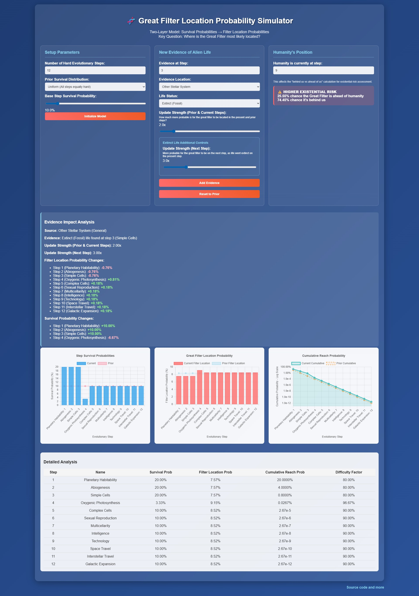

# The Great Filter Toy-Model

A small interactive toy model for exploring how evidence about extraterrestrial life changes where the [Great Filter](https://en.wikipedia.org/wiki/Great_Filter) is most likely to be.

The page starts from a prior over a sequence of hard evolutionary steps and then updates that belief when you add new evidence. It handles two cases: extant life, where alien life is still alive, and extinct life, where the evidence is a fossil or dead biosignature. Depending on the strength and location of the update, the model can shift probability toward the Great Filter being behind us or still ahead of us.

This is meant to make the Bayesian intuition behind the Great Filter easier to see, not to settle the Fermi paradox. It is inspired by Nick Bostrom’s discussion of how finding life elsewhere would change our expectations about humanity’s future, and by a discussion I had with someone where we were on opposite sides of the update: would finding evidence of fossil life move part of the probability of the Great Filter back or ahead of us? I thought ahead; he thought back. It seems, by the simulator, that it depends on your update on the new evidence.

## On the page

- Choose the number of hard evolutionary steps
- Pick a prior shape for step difficulty
- Set the base survival probability per step
- Add evidence by choosing the step, location, and whether the life is extant or extinct
- Compare survival, filter-location, and cumulative probability charts

## Demo

[Open the live demo](https://ferdesmello.github.io/the-great-filter-toy-model/)

